<picture>
  <source media="(prefers-color-scheme: dark)" srcset="resources/banner-dark.svg" />
  <source media="(prefers-color-scheme: light)" srcset="resources/banner-light.svg" />
  
</picture>

### Who Am I?

- Software and Robotics Engineer, 🎓 B.Sc. Mechatronics Engineering
- M.Sc. student in Computational Science and Engineering @ TUM
- 🗺️ lifelong traveller (27/195 countries so far)
- Fun fact: as a child, I took apart toys just to figure out how to build my own

### Publications

- **AROLA: A Modular Layered Architecture for Scaled Autonomous Racing**, IEEE Intelligent Vehicles Symposium (IV), 2026. [arXiv](https://arxiv.org/abs/2602.02730)
- **Comfort-Aware Speed Planning over Road Anomalies: A Reinforcement Learning Approach**, B.Sc. thesis, TU Berlin, 2026. [DOI-DepositOnce](https://doi.org/10.14279/depositonce-26841)

Want to know more? Visit my portfolio at **[mohammedazab.com](https://mohammedazab.com)**

### GitHub Stats

  

---

### Words to Live By

---

<picture>
  <source media="(prefers-color-scheme: dark)" srcset="https://raw.githubusercontent.com/Mohammed-Azab/Mohammed-Azab/output/github-snake-dark.svg" />
  <source media="(prefers-color-scheme: light)" srcset="https://raw.githubusercontent.com/Mohammed-Azab/Mohammed-Azab/output/github-snake.svg" />
  
</picture>
